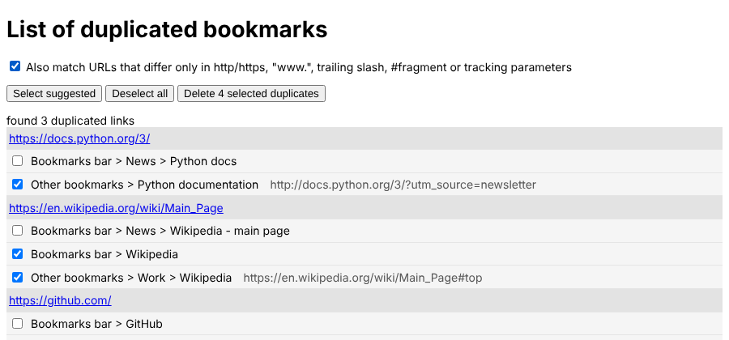

<p align="center">
  
</p>

<h1 align="center">Bookmark Cleaner</h1>

<p align="center">
  <b>Years of bookmarks, zero duplicates — in one click.</b><br>
  A tiny, private, open-source Chrome extension that finds every duplicated
  bookmark and lets you clean them up safely.
</p>

<p align="center">
  <a href="https://github.com/wiso/chrome-duplicates/actions/workflows/ci.yml"></a>
  
  
  
</p>



## Why?

You saved that article in *Read later*, then again in *Work*, then once more
from your phone. Multiply by a few years and your bookmarks are a maze.
Chrome has no built-in way to find duplicates — **Bookmark Cleaner** does it
for you in a second, across every folder, including the ones synced from
your other devices.

## Features

- 🔍 **Finds every duplicate** across all your folders and shows exactly
  where each copy lives (`Bookmarks bar > News > …`).
- 🧠 **Smart matching** (optional): `http://www.site.com/page/`,
  `https://site.com/page#top` and `https://site.com/page?utm_source=newsletter`
  are recognized as the same page.
- ✅ **Sensible defaults**: the oldest copy is kept, the others are
  pre-selected. Change the selection with a click.
- 🛡️ **You can't lose a bookmark**: at least one copy of each link is always
  kept, even if things change while you are deciding.
- ↩️ **Undo**: changed your mind? One click puts every deleted bookmark back,
  in its original folder and position.
- 🔄 **Always up to date**: the list refreshes by itself when your bookmarks
  change, without losing your selection.
- 🔒 **Private by design**: no network access, no tracking, no analytics. It
  asks for one permission only — your bookmarks — and everything stays on
  your computer.
- 🪶 **Lightweight**: a few kilobytes of plain JavaScript, no frameworks.

## How to use it

1. Click the Bookmark Cleaner icon in the toolbar.
2. Review the duplicates, grouped by link. Click a title to (de)select it,
   or click the link to open it in a new tab.
3. Press **Delete selected duplicates**, confirm, done. Press **Undo** if you
   need it.

## Install

Bookmark Cleaner requires Chrome 90 or later; it should also work in other
Chromium-based browsers such as Edge and Brave.

To install it from source:

1. Download this repository (*Code → Download ZIP*) and unzip it.
2. Open `chrome://extensions` and switch on **Developer mode**.
3. Click **Load unpacked** and select the unzipped folder.

## Contributing

Bug reports, ideas and pull requests are welcome — open an
[issue](https://github.com/wiso/chrome-duplicates/issues)!

The logic that finds the duplicates lives in `duplicates.js`, independent of
the Chrome API, and is tested with node:

```
node --test
```
